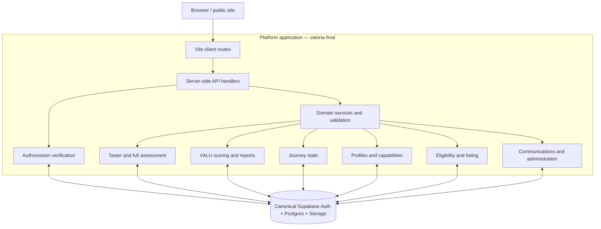

# Valoria Institute — Target System Design (Platform)

**Document ID:** VI-SD-2026-001  
**Repository:** `riverwayse-sudo/valoria-platform`  
**Application path observed:** `valoria-final/`  
**Application role:** Authenticated product workflows, canonical business rules and platform APIs  
**Status:** Proposed target architecture; validate against implementation before refactoring.

## 1. System position

Valoria is one product delivered through two separately deployable applications and one canonical data platform:
- `valoria-site` (Next.js) owns institutional/public web content and public discovery.
- This repository's `valoria-final/` currently contains the Vite application and server-side API handlers. It owns authenticated product workflows and authoritative business rules.
- Supabase is the canonical identity and persistence layer shared by the applications.

Keep the two-app architecture. Do not merge repositories or prematurely extract microservices. The objective is explicit domain ownership, stable API contracts, durable state transitions and regression protection.

## 2. Domain architecture and ownership

| Domain | Platform authority | Invariant |
|---|---|---|
| AUTH | Supabase Auth integration and server-side identity boundary | One canonical identity; validate every protected request |
| TAS | Taster lifecycle and persistence | Nine directional questions; save/resume; not official VALU Index |
| ASM | Full assessment lifecycle | 58-question product assessment; durable answers; idempotent submission |
| SCO | Scoring, VALU Index, PRIME points, merit/certification rules | One scoring implementation; points, never percentage labels |
| DASH | Journey state and transition rules | Persisted state, not UI-derived guesses |
| PROF | Professional identity/profile/capabilities | One account → one canonical profile → multiple capabilities |
| MKT | Eligibility, listing and public marketplace projections | Assessment completion distinct from eligibility and public listing |
| COM | Confirmation, recovery, notifications and report delivery | Delivery state observable; email failure does not corrupt core progress |
| EVT | Authenticated event registration and related persistence | Registration ownership and deduplication explicit |
| ADM | Reconciliation, audit trail and privileged administration | Least privilege, evidence-based, reversible operations |
| INF | APIs, migrations, RLS, runtime and environment configuration | Secure defaults and environment isolation |

The public site consumes platform-owned records and decisions. It must not reproduce platform scoring, identity, journey or eligibility rules.

## 3. Logical architecture

This is a logical view. Do not create a separate service for every box. Keep domain logic modular within the existing application until independent scaling, security or release requirements justify extraction.

## 4. Canonical user journey and state

1. Visitor chooses **Create account** or **Sign in** from the site entry surface. Signup/sign-in should be a concise modal or entry experience, not a complicated pre-assessment funnel.
2. New users create an account, confirm email and return to the dashboard with a valid session; no second sign-in is required. Existing users sign in and resume their saved journey.
3. Dashboard reads canonical journey state and directs the user to one clear next action, prioritising assessment continuation.
4. The authenticated user starts or resumes the 9-question directional taster. It is introductory and does not establish the official VALU Index.
5. Taster progress and identity association persist; users can resume without losing answers.
6. The user proceeds to the 58-question full assessment according to the authoritative, versioned assessment configuration. The UI must not guess whether the 9-question taster is included in that count.
7. Answers persist incrementally and resume at the next unanswered question.
8. Submission is idempotent and yields one canonical assessment result.
9. SCO computes official VALU Index and PRIME points from the canonical submission.
10. Profile setup is a distinct workflow; it must not reset or block assessment progress. Dashboard prioritises assessment until complete.
11. Profile summaries/capabilities are derived from authoritative report/assessment data.
12. MKT evaluates eligibility and listing as separate decisions. Completing an assessment does not require a minimum score; a 35-point rule, where applicable, is an eligibility rule and must not block completion.
13. One professional identity can expose Talent, Speaker and Facilitator capabilities under the same profile, subject to the current listing policy.

### State dimensions must remain separate

- Account: pending confirmation / confirmed / disabled (map to actual Auth state).
- Taster: not started / in progress / submitted.
- Full assessment: not started / in progress / submitted.
- Result: pending / generated / report available.
- Profile: incomplete / complete.
- Eligibility: unevaluated / eligible / not eligible / review required.
- Listing: unpublished / published / suspended.

These are conceptual dimensions, not a demand to add new database enums. Inventory existing schema and map before migrations. Do not collapse them into one overloaded status field.

## 5. Domain contracts

Each API must define:
- Canonical method/path and version.
- Auth requirement and owner check.
- Validated request/response schema.
- Stable error code and safe user-facing message.
- Idempotency key semantics for writes.
- Retry and timeout behaviour.
- Data owner and persistence transaction boundary.
- Contract and regression tests.

Critical contracts:
- Account creation and confirmation/session establishment.
- Taster init, progress read/write and submit.
- Assessment progress read/write and submit.
- Taster-to-account/assessment linking.
- Result/VALU Index generation and report delivery.
- Profile create/update and capability persistence.
- Eligibility evaluation and listing publication.
- Dashboard journey-state read.

The site proxy must forward only explicitly approved platform paths. Platform SPA fallback must never swallow API or static asset requests.

## 6. Data integrity and security

- Use the authenticated Supabase user ID as the canonical account identity.
- Validate IDs before querying or invoking RPCs; never send null/invalid UUIDs to database functions.
- Server-side handlers must verify session, ownership and role. Client-side route protection is UX only.
- Never use user-editable metadata as an authorization source.
- Use least-privilege RLS and server credentials. Service-role keys must never be present in Vite client variables or browser bundles.
- Keep preview/staging isolated from production Supabase data.
- Use transactions/constraints for atomic assessment submission, identity linking and unique listing rules where compatible with existing schema.
- Preserve all existing user, answer, score, report and profile records.
- Privileged reconciliation must be auditable, scoped, evidence-backed and reversible.
- Do not expose private email addresses in public profile or marketplace payloads.

## 7. Persistence and lifecycle guarantees

- Assessment progress is durable across refresh, navigation, token refresh and temporary network loss.
- Resume derives from persisted answers and authoritative assessment version, not local component state alone.
- Submission is idempotent; duplicate requests do not create duplicate results or profiles.
- Taster/account linking is explicit and safe for already-authenticated and signed-out users.
- Dashboard reads canonical journey state; it does not calculate completion from unrelated records.
- Score calculation is deterministic and versioned. A scoring change must preserve the historical score/report version.
- Profile and marketplace projection failures must not erase the underlying assessment or profile.

## 8. Observability

Capture structured, privacy-safe events for:
- Account created, confirmation sent/verified, session established.
- Taster started, progress saved, submitted, linked.
- Assessment started/resumed, answer saved, submitted.
- Scoring started/completed, report generated/delivered.
- Profile created/updated, capability changed.
- Eligibility evaluated, listing published/withheld.
- Auth failures, ownership denials, RPC/API errors, retry outcomes and latency.

Attach request/correlation IDs. Do not log passwords, access tokens, service keys or unnecessary answer payloads. Provide operators with a trace from user action to API request to database operation.

## 9. Deployment and environment model

- This application currently uses Vite and server-side API handlers under `valoria-final/`; verify the configured Vercel project root and runtime before changing deployment files.
- The site is a separate Next.js project with its own proxy configuration.
- Use explicit platform upstream origins per environment. Preview must not silently fall back to production.
- Test platform endpoints directly and through the public-site proxy.
- Verify actual built JS/CSS paths, API routing, HTTP methods, cookies/session propagation, CORS and SPA fallback behaviour.
- No production deployment or DNS change during architecture documentation or audit.
- Promote only after module tests, API contract tests, cross-app integration and browser acceptance tests pass.

## 10. Regression gates

- Unit tests for scoring, eligibility, state transitions and validation.
- API tests for method, auth, ownership, schema, error and idempotency.
- Database tests for migrations, RLS, constraints and RPC payload contracts.
- Integration tests for site proxy → platform API → Supabase.
- End-to-end tests for signup/confirmation, taster, resume, full assessment, result, profile and marketplace.
- Staging browser checks including mobile.
- Production smoke checks after controlled promotion.

A successful build alone is not an acceptance result.

## 11. Immediate validation backlog

1. Confirm repository layout and configured project root (`valoria-final/` is the observed app path).
2. Inventory all API handlers and map them to AUTH/TAS/ASM/SCO/DASH/PROF/MKT/COM/ADM.
3. Inventory Supabase migrations, RPCs, RLS policies, triggers and relevant schema. Do not alter schema until dependencies are mapped.
4. Trace auth/session creation and verification end-to-end.
5. Trace assessment progress and submission payloads through API → RPC → persisted record.
6. Verify canonical score calculation and historical versioning.
7. Trace profile and marketplace projection from assessment result to public listing.
8. Define route contracts with `valoria-site` and implement contract tests.
9. Reconcile deployment target and environment variables without disclosing secret values.
